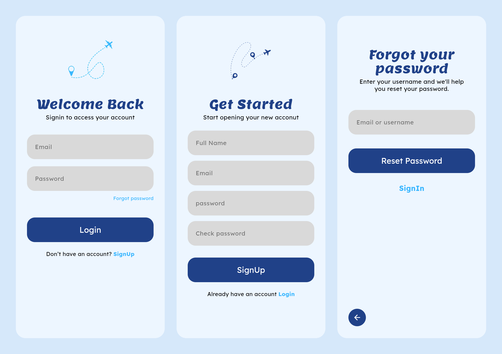
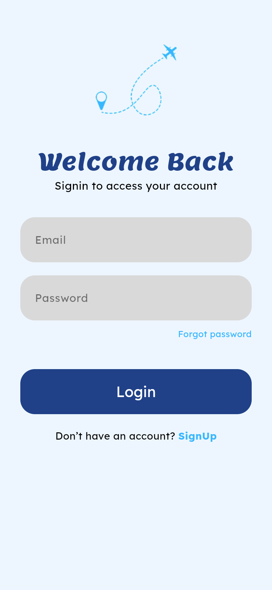
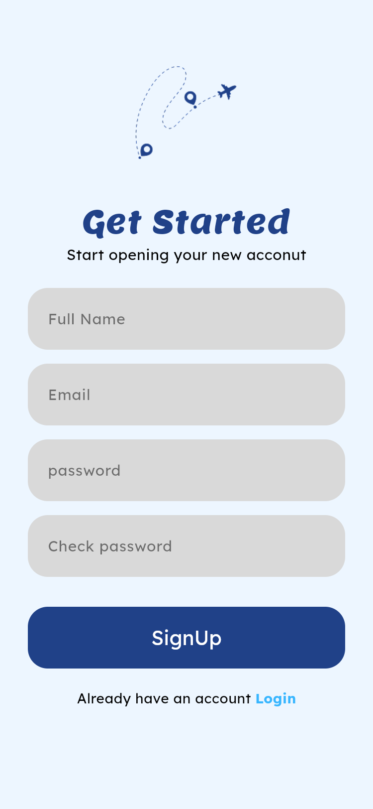
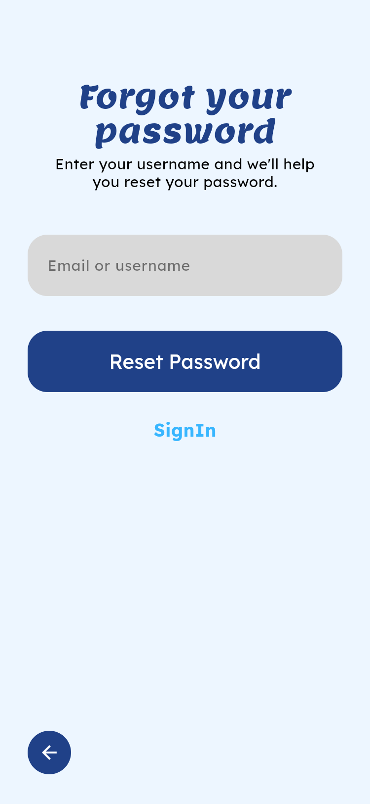

# Travel Auth App

A travel-themed authentication UI built with Flutter, using a soft light-blue background, navy and sky-blue accents, and airplane route illustrations.



## Features

- **Login screen**: light-blue airplane illustration, email and password fields, a **Forgot password** link, a **Login** button and a link to sign up.
- **Sign Up screen**: dark-blue airplane illustration, full name, email, password and confirm-password fields, a **SignUp** button and a link back to login.
- **Forgot Password screen**: an email or username field, a **Reset Password** button, a **SignIn** link and a back button.
- **Reusable widgets**: shared header, text field, button and illustration widgets keep the screens consistent.
- **Typography**: [Lemon](https://fonts.google.com/specimen/Lemon) for titles and [Lexend Deca](https://fonts.google.com/specimen/Lexend+Deca) for body text, via `google_fonts`.

## Screenshots

| Login | Sign Up | Forgot Password |
| :---: | :---: | :---: |
|  |  |  |

## Tech Stack

- [Flutter](https://flutter.dev) / Dart (Material 3)
- [google_fonts](https://pub.dev/packages/google_fonts)

## Project Structure

```
lib/
├── main.dart          # App entry point and theme
├── screens/           # Login, Sign Up and Forgot Password
└── widgets/           # Reusable widgets (header, text field, button, airplane illustration)
assets/
└── images/            # Airplane route illustrations (light and dark)
```

## Getting Started

1. Install the [Flutter SDK](https://docs.flutter.dev/get-started/install).
2. Clone the repository:
   ```bash
   git clone https://github.com/hamza-1612/travel_auth_app.git
   cd travel_auth_app
   ```
3. Install dependencies:
   ```bash
   flutter pub get
   ```
4. Run the app:
   ```bash
   flutter run
   ```
